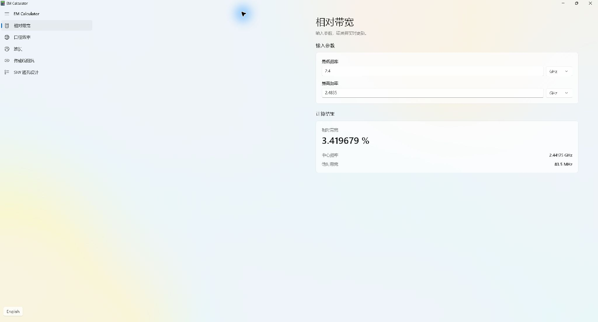

# EM Calculator

Windows 原生电磁工程计算器，使用 **C#、WinUI 3 和 Windows App SDK**。界面采用系统 Mica 背景、原生控件和卡片布局，支持中文与 English，突出核心计算结果。

Native Windows electromagnetic engineering calculator built with C# and WinUI 3. The application follows the system theme, uses Mica where available, and provides Chinese and English interfaces.



## 当前开发状态

**0.4.1 提供自签名 MSIX 试用版。** UI、计算、测试及构建发布均使用 .NET；项目不再包含 Electron、React、Node.js 或 Python 实现。v0.4.0 是首个以 WinUI 3 为唯一实现的版本，v0.3.0 及更早下载是历史 Electron 版本。

Windows x64 是当前构建与打包目标。项目声明的最低系统为 Windows 10 1809；目前本地验证环境为 Windows 11，旧版 Windows 和干净机器的运行验证仍待完成。Mica 的实际效果随系统主题、壁纸、透明效果和系统能力变化。

## 计算功能

| 功能 | 输出及模型 |
|---|---|
| 相对带宽 | 相对带宽、绝对带宽、中心频率 |
| 口径效率 | 效率、有效口径面积、波长；超过 100% 时提示 |
| 波长 | 自由空间与均匀介质内波长、半波长、四分之一波长、相速度 |
| 传输线阻抗 | Microstrip、CPW、GCPW、Coaxial 的阻抗、有效介电常数、相速度 |
| SIW 通孔设计 | 推荐孔径、孔距、等效宽度、TE₁₀ 截止频率及截止提示 |

频率支持 Hz/kHz/MHz/GHz；长度支持 mm/µm/mil；面积支持 m²/cm²。支持科学计数法，输入后实时计算。页面、语言和传输线类型切换时保留当前会话输入；MSIX 版将语言偏好保存在应用私有数据目录，卸载时由 Windows 清理；便携版使用 `%LOCALAPPDATA%/EMCalculator/settings.json`。计算输入不写入磁盘。

模型采用无损、准静态近似。微带线采用零导体厚度的 Hammerstad–Jensen 模型；CPW/GCPW 采用共形映射；同轴线采用 TEM 模型。SIW 通孔推荐使用介质波长，不等同于色散波导中的导波波长。详见 [计算模型与验证](docs/calculations.md)。

## 开发与运行

需要 Windows 和 **.NET 8 SDK**，依赖由 NuGet 恢复。不需要 Node.js、npm、Python，也不需要安装 Visual Studio 才能使用命令行构建。Visual Studio 用户可打开 `EMCalculator.sln`，选择 x64。

在仓库根目录运行 PowerShell：

```powershell
./build.ps1 -Task Verify          # 运行计算回归测试并构建原生应用
./build.ps1 -Task Run -Configuration Debug
./build.ps1 -Task Package         # 生成 Windows x64 MSIX 候选包
./build.ps1 -Task Publish         # 测试 + 旧式独立 ZIP
```

也可直接使用 .NET CLI：

```powershell
dotnet run --project tests/EMCalculator.Tests -c Release
dotnet build src/EMCalculator/EMCalculator.csproj -c Debug -p:Platform=x64
dotnet publish src/EMCalculator/EMCalculator.csproj -c Release -r win-x64 --self-contained true -p:Platform=x64 -o artifacts/publish/win-x64
```

单项目 MSIX 发布命令为 `./build.ps1 -Task Package -Version 0.4.1`。提交 Microsoft Store 前，需要把 `Package.appxmanifest` 和 `Directory.Build.props` 中的包名与 Publisher 值替换为 Partner Center 分配的身份。Store 会为上架包签名；直接从网站分发 MSIX 则需要受信任的代码签名证书。

计算回归测试使用一个无第三方测试框架依赖的控制台运行器，断言失败会返回非零退出码。不要用 `dotnet test` 替代上述 `dotnet run` 命令。

## 打包与下载

`Package` 输出 Windows x64 MSIX 候选包，适合提交 Microsoft Store。目前候选包约 **41.9 MiB**；v0.4.0 独立 ZIP 约 **66.4 MiB**。Windows App SDK Framework 作为共享依赖单独管理，首次安装时若系统缺少它，安装流程还需要获取该运行时。MSIX 包内仍携带 .NET 运行时，因此在干净系统上也能启动。安装后的应用由 Windows 管理，可从开始菜单或“设置 → 应用”启动和卸载。正式商店提交还需要设置 Partner Center 分配的包名和 Publisher 身份。

自签名试用包需要用户手动将附带的开发证书导入本地计算机的“受信任的人员”，并在缺少 Windows App Runtime 时安装附带的依赖；卸载应用不会移除该证书。公开分发可使用受信任的代码签名证书，Microsoft Store 会在审核后重新签名。旧式独立 ZIP 仍可通过 `Publish` 任务生成，便于需要免安装便携版的场景。

GitHub Actions 可手动生成未签名的 MSIX 构建产物；发布用的自签名包需单独签名。正式商店上架需在 Partner Center 完成提交。历史版本见 [Releases](https://github.com/SamDu1998/EM_Calculator/releases)。

## 项目结构

```text
src/EMCalculator/          WinUI 3 应用、导航、输入和结果展示、偏好设置
src/EMCalculator.Core/     独立的纯 C# 计算、验证与单位换算
tests/EMCalculator.Tests/  参考数据、数值回归与边界检查
build.ps1                 统一测试、构建、运行和打包入口
.github/workflows/        Windows CI 和发布流程
```

## 后续工作

- 干净机器及 Windows 10 兼容性验证
- 原生 UI 自动化测试、键盘和高对比度检查
- 传输线与 SIW 结构示意图
- 评估发布包裁剪、签名与更新方式

## License

MIT
